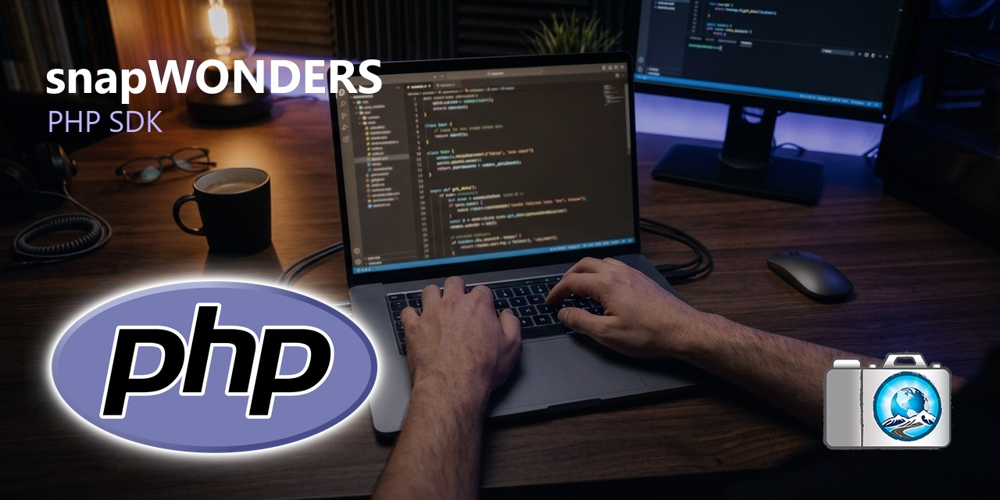
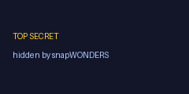

<p align="center">
    <a href="https://www.snapwonders.com/" target="_blank">
        
    </a>
</p>

snapWONDERS — Expose what's hidden. Hide what's yours.


# snapwonders/sdk — PHP client for the snapWONDERS API

The official PHP client for the snapWONDERS API: steganography, forensic media analysis, and format
conversion. The client wraps the resumable TUS upload and the session → job → poll → download
choreography so that a whole job is a couple of lines.

All the snapWONDERS API services are available over the Clearnet / **Web** and Dark Web **Tor** and
**I2P**.

> **Status.** Initial release (`0.1.0`). Not yet published to Packagist.


# See it in action

Hide a secret image inside a cover — the stego output looks pixel-identical, but carries the hidden
file, recoverable only with the password:

| Secret (hidden inside) | Cover (input) | Stego output (carries the secret) |
|---|---|---|
|  |  |  |

The full walkthrough — steganography, forensic analysis (with a real graded result), and conversion —
is in **[`examples/WALKTHROUGH.md`](https://github.com/snapWONDERS/snapWONDERS-SDK-PHP/blob/main/examples/WALKTHROUGH.md)**.


# Installation and setup

## snapWONDERS API key
You will need a snapWONDERS API key before you can get started:

* Sign up and create an account at [snapWONDERS sign-up](https://snapwonders.com/sign-up). If you
  wish to create an account via Tor or I2P then you can do so by accessing snapWONDERS through the
  Tor or I2P portals. For the dark web links visit
  [browsing safely](https://snapwonders.com/browsing-safely).
* Under your account settings, generate an API key. New keys start with `sw_`. It is sent as the
  `X-Api-Key` header on every request — keep it secret.

## Requirements

PHP 8.2+, with the `curl` and `json` extensions (both standard). No other runtime dependencies.

## Install the package

```bash
composer require snapwonders/sdk    # once published
```


# Quickstart

```php
<?php

require __DIR__ . '/vendor/autoload.php';

use SnapWonders\Client;

$client = new Client('sw_your_key_here');   // base URL defaults to https://snapwonders.com
print_r($client->status());                  // no key needed for status

// Hide a secret inside a cover image (the last file is the cover).
$job = $client->stego->hide(['secret.png', 'cover.jpg'], password: 'Str0ng!Pass');
foreach ($job->results() as $result) {
    $result->download('out/');               // "out/" is a directory — the server filename is kept
}

// Reveal it again.
$job = $client->stego->reveal('out/cover-share.avif', password: 'Str0ng!Pass');
$job->results()[0]->download('recovered/');
```

`$client->analyse` (forensic analysis) and `$client->convert` (media conversion) follow the same
shape — one call in, results out:

```php
// Forensic analysis — grade each file A–F, collect the overlay assets it produced.
$job = $client->analyse->run(['photo.jpg'], options: ['face_detection' => true]);
foreach ($job->results() as $item) {
    echo "{$item->filename}  {$item->grade}  faces={$item->faceCount}\n";
    foreach ($item->assets as $asset) {      // ELA map, face overlay, …
        $asset->download('out/');
    }
}

// Convert media — the image format key is `image_format` (jpeg/png/webp/avif/heic/jxl).
$job = $client->convert->run(['photo.png'], options: ['image_format' => 'webp']);
$job->results()[0]->download('out/');
```

Prefer to drive each stage yourself? The step-by-step surface is public too:
`createSession()` → `upload($path, $step)` → `waitForUploads()` → `startJob(...)` → `wait()` →
`results()`.


# Examples

Runnable end-to-end examples live in [`examples/`](https://github.com/snapWONDERS/snapWONDERS-SDK-PHP/tree/main/examples) — steganography, forensic analysis,
and conversion, each a self-contained script with a bundled sample image:

```bash
composer install
export SNAPWONDERS_API_KEY=sw_your_key_here
php examples/hide_and_reveal.php     # hide a file in an image, then reveal it
php examples/analyse.php             # grade an image A–F + download overlay assets
php examples/convert.php             # PNG → WebP
```

See [`examples/README.md`](https://github.com/snapWONDERS/snapWONDERS-SDK-PHP/blob/main/examples/README.md) for how to run them.


# Errors

Every failure the SDK raises is a typed subclass of `SnapWonders\Exception\SnapWondersException`, so
you can branch on the kind of failure rather than inspecting HTTP status codes:

| Exception | Raised when |
|-----------|-------------|
| `AuthException` | Missing, malformed, unknown, or revoked API key |
| `ProRequiredException` | A Pro-only option was used on a free account |
| `SessionExpiredException` | The 24-hour upload session window has passed |
| `RateLimitException` | Rate limited — carries `retryAfter` when the server supplies it |
| `MaintenanceException` | snapWONDERS is temporarily unavailable for maintenance — carries `retryAfter` |
| `JobFailedException` | A job finished as `failed` — carries the server's reason |
| `TusUploadException` | A resumable-upload step failed |
| `NetworkException` | The API could not be reached |
| `ApiException` | Any other non-2xx response |


# Running the tests

```bash
composer install
composer test                # offline unit tests — no API key required
```


# Documentation

Useful documentation can be found at:

* The interactive Swagger UI and full endpoint reference:
  [snapWONDERS API](https://snapwonders.com/api)
* A guided, step-by-step integration walkthrough:
  [snapWONDERS Developers](https://snapwonders.com/developers)


# Contact

## For security concerns
If you have spotted any security concerns then please reach out via
[contacting snapWONDERS](https://snapwonders.com/contact) and set the subject to
**"SECURITY CONCERNS"** and provide the information about your concerns. If you wish to contact via
Tor or I2P then you can do so by accessing snapWONDERS through the Tor or I2P portals. For the dark
web links visit [browsing safely](https://snapwonders.com/browsing-safely).

## For FAQ and questions
It may be that your question is already answered in the [FAQ](https://snapwonders.com/faq). Be sure
to check the FAQ content first. Otherwise you may reach out via
[contacting snapWONDERS](https://snapwonders.com/contact).

## For contacting the author
Use this link to contact the author [Kenneth Springer](https://kennethbspringer.au/).


# Licence

MIT — Copyright (c) 2026 Kenneth Springer @ snapWONDERS. See [LICENSE](https://github.com/snapWONDERS/snapWONDERS-SDK-PHP/blob/main/LICENSE).

**Scope.** The MIT licence covers **this client library only**. It grants no rights in the
snapWONDERS API, service, data, models, or algorithms it communicates with — these are **proprietary**
and remain the property of Kenneth Springer @ snapWONDERS. This library only sends HTTP requests to
the API; it contains none of its implementation. Using the API requires a valid API key and is
governed by the [snapWONDERS Terms of Service](https://snapwonders.com/terms).
